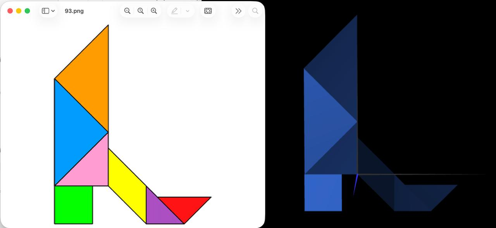

# CG 2025/2026

## Group T10 G03

## TP 2 Notes

### Exercise 1

In exercise 1 we recreated the tangram applying geometric transformations to already created objects. At the begginning, We had some difficulties understanding how to apply the transformations, and placing the figures in the right place, but after some trial and error we managed to do it:

- Applied the translation and rotation to the diamond using matrix multiplication operations, described in section 1;
- Applied the translation and rotation to the other figures using the instructions for geometric transformations described in section 2;
- Created the tangram class.

### Exercise 2

In exercise 2 we created a 3D object (unit cube) and applied transformations to it.

- Created the MyUnitCube class, and defined the vertices and indices of the cube;
- Displayed the cube in the scene, and applied transformations to place the tangram and cube in the right places.

### Exercise 3

In exercise 3 we created a new unit cube using a quad plane drawn multiple times to define the six faces.

- Created the MyQuad class, representing a unit square centered at the origin, (with both-sided indices for visibility from both directions);
- Created the MyUnitCubeQuad class, which holds a single MyQuad instance;
- Replaced the previous MyUnitCube in the scene with this new MyUnitCubeQuad, applying the same geometric transformations as before.

