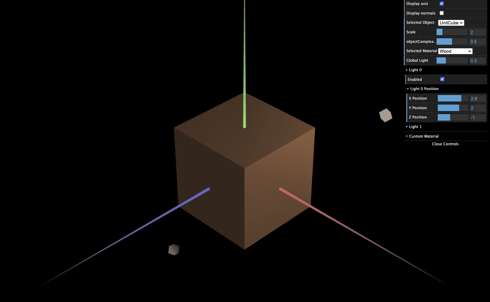
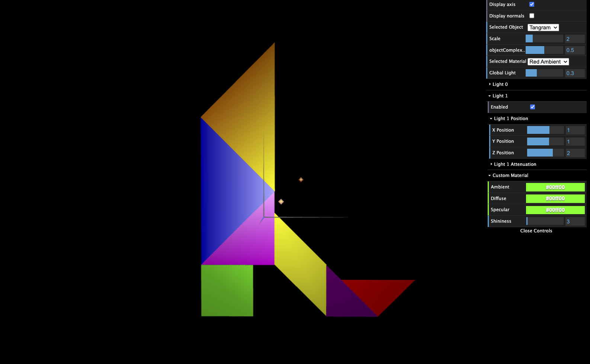
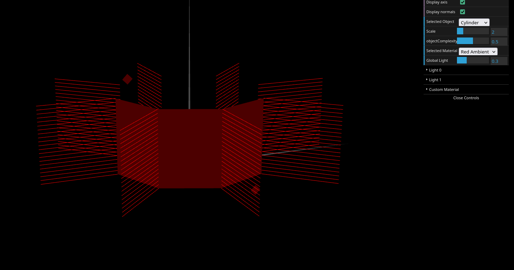

# CG 2025/2026

## Group T10 G03

## TP 3 Notes

### Part 1 

We started part 1 by adding an instance of `MyTangram` and of `MyUnitCube` to `MyScene`'s `init()` by appending them in the `objects` array and adding the respective entry in the `objectsIDs` map. 

Then we declared the normals for all different objects in their respective `initBuffers()` function. We had to repeat vertices on the cube because they were shared by multiple faces in different orientations. 

Afterwards we created a wood material and added it to the scene's materials list in the interface. Here is the wood material's code and look:

```js
// Wood (brown ambient, low specular)
        this.materialWood = new CGFappearance(this);
        this.materialWood.setAmbient(0.506, 0.329, 0.22, 1.0);
        this.materialWood.setDiffuse(0.506, 0.329, 0.22, 1.0);
        this.materialWood.setSpecular(0.1, 0.1, 0.1, 1.0);
        this.materialWood.setShininess(5.0);
```



Then, we defined a material with high specular component for each tangram piece, corresponding to their colors in the tangram reference picture. After that, we changed the material of the MyDiamond object to the scene's custom material, so we could change it in the interface, seen below in green:



### Part 3
In this exercise, we edited the previous angle to be perpendicular to the surface to make it appear smooth when lit. Furthermore, we eliminated repeated vertices and normals by changing the way we rendered per stack. Instead of creating two vertices at a time, we only created one per stack inside the per slice loop.