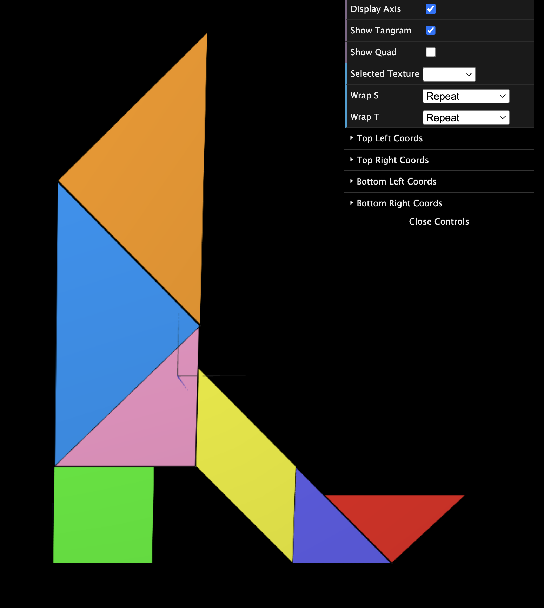
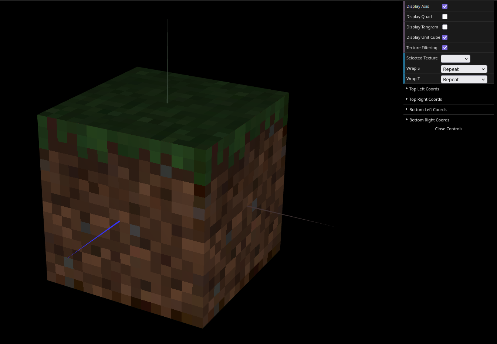

# CG 2025/2026

## Group T10 G03

## TP 4 Notes

### Exercise 1

We started by including in TP4 the `MyTangram` class and all of its piece classes. Then, in the interface, we added a checkbox to control the visibility of `MyQuad` (`displayQuad`).

Next, we applied textures to the Tangram:

1. We created materials in the `MyTangram` class using the `images/tangram.png` texture.
2. We defined texture coordinates for each piece so that the geometric edges align with the corresponding shape in the texture image.

For `MyTriangleBig` and `MyTriangleSmall`, texture coordinates were updated before each draw call with `updateTexCoords(...)`, allowing the same geometry to be reused with different mappings for each triangle.

We also defined texture coordinates directly in the buffers of pieces such as `MyDiamond`, `MyTriangle`, and `MyParallelogram`, so each piece uses the correct region of the tangram texture.



### Exercise 2

We copied the `MyUnitCubeQuad` class from TP2 and changed its constructor to receive six optional textures in the following order:

- top (+Y)
- front (+Z)
- right (+X)
- back (-Z)
- left (-X)
- bottom (-Y)

In `MyScene`, we created the `mineTop.png`, `mineSide.png`, and `mineBottom.png` textures, and instantiated the cube with the side texture repeated on the four lateral faces.

Then we updated the cube's `display()` to apply each texture to the correct face. To solve the sharpness issue caused by the 16x16 textures, we added filtering control through a checkbox (`textureFiltering`) and used:

```js
this.scene.gl.texParameteri(
  this.scene.gl.TEXTURE_2D,
  this.scene.gl.TEXTURE_MAG_FILTER,
  this.scene.textureFiltering ? this.scene.gl.NEAREST : this.scene.gl.LINEAR,
);
```

This allows switching between linear filtering (smoother) and nearest filtering (the intended pixelated effect).


