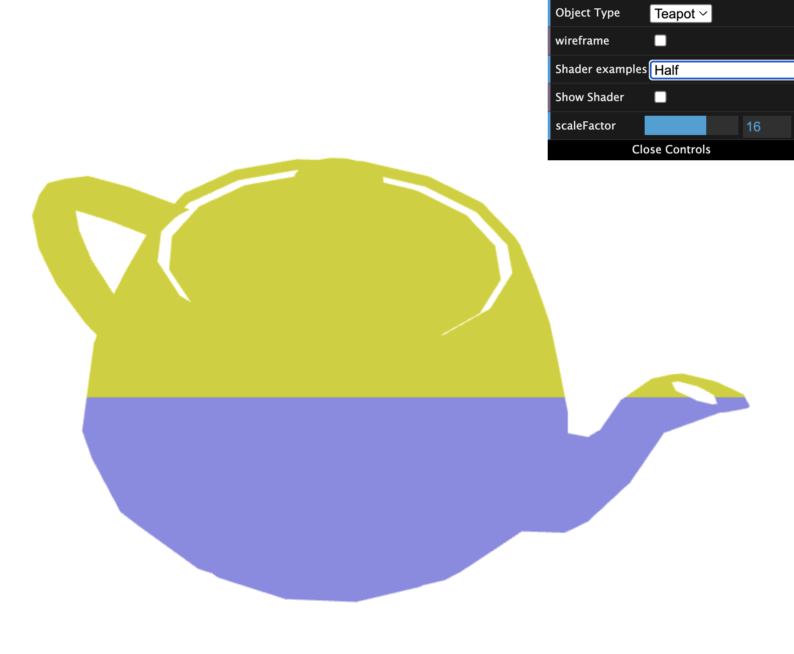
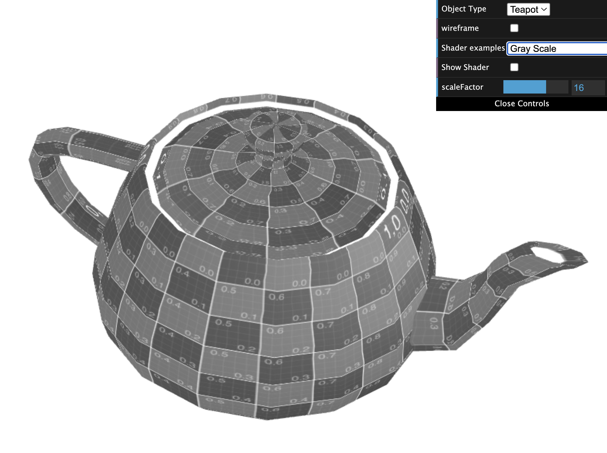

# CG 2025/2026

## Group T10 G03

## TP 5 Notes

### Exercise 1

In this exercise, we implemented three shader changes:

1. We created `half.vert` and `half.frag` to color the teapot based on screen position, using the transformed vertex position passed from vertex shader to fragment shader:
   yellow for the top half (`y > 0.5`) and blue for the bottom half.
2. We updated `texture3anim.vert` to add a sinusoidal translation on the X axis (back and forth motion), scaled by the interface `scaleFactor` (`normScale`).
3. We created `grayScale.frag` from the sepia shader, converting color to grayscale with:
   $$L = 0.299R + 0.587G + 0.114B$$
   and applying it equally to RGB.

